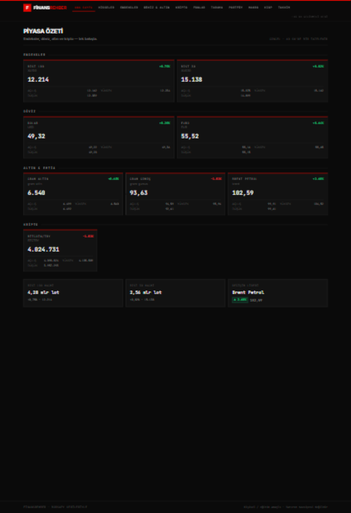
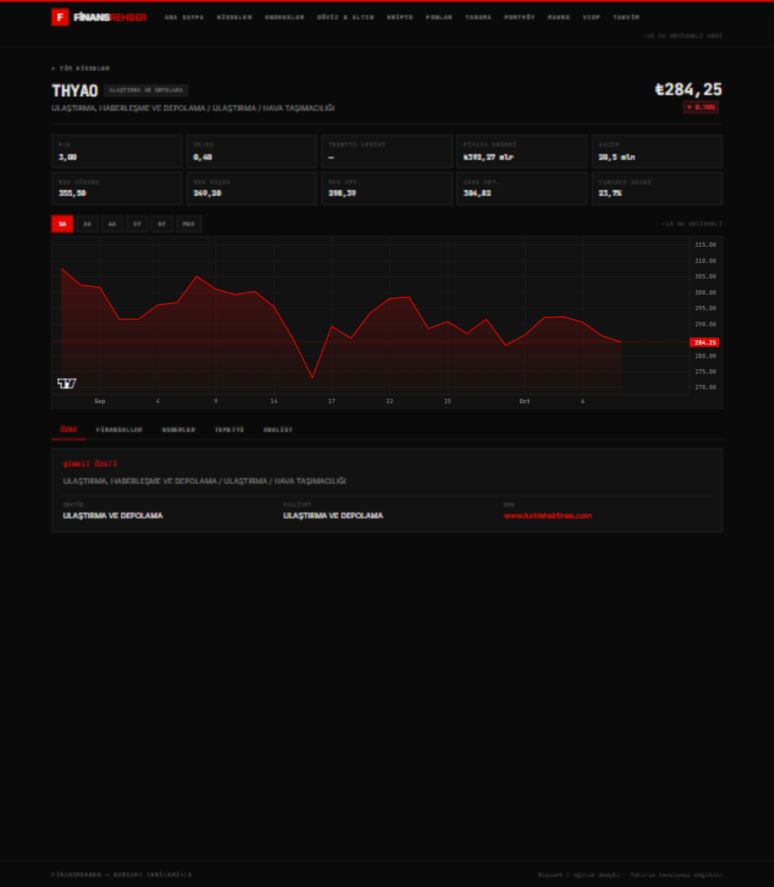
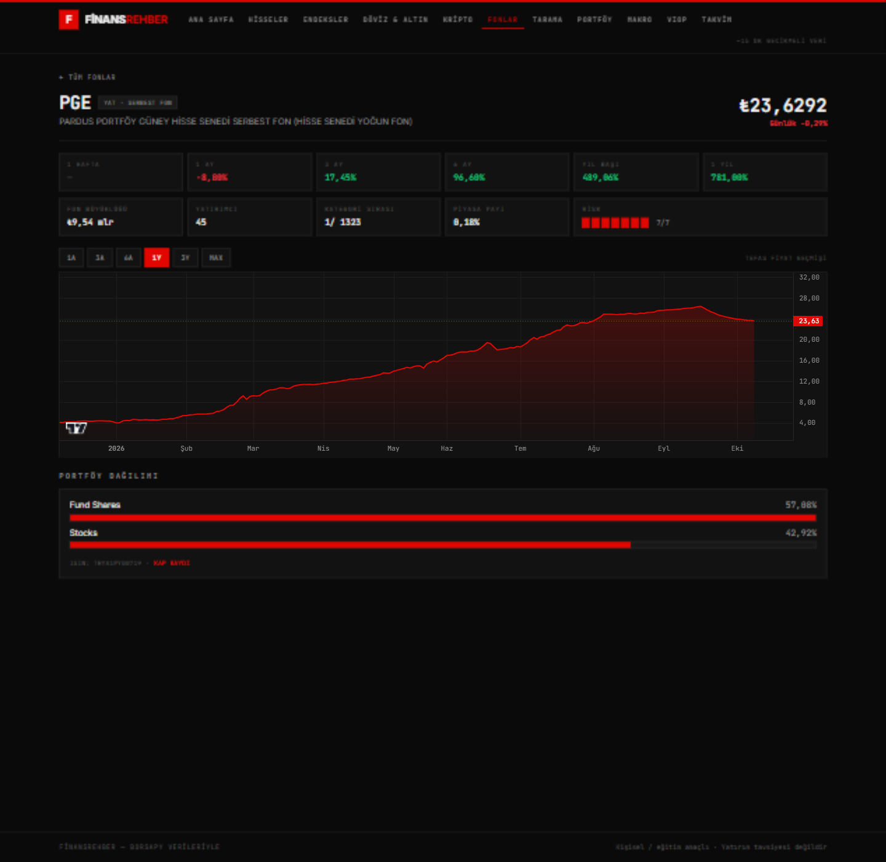
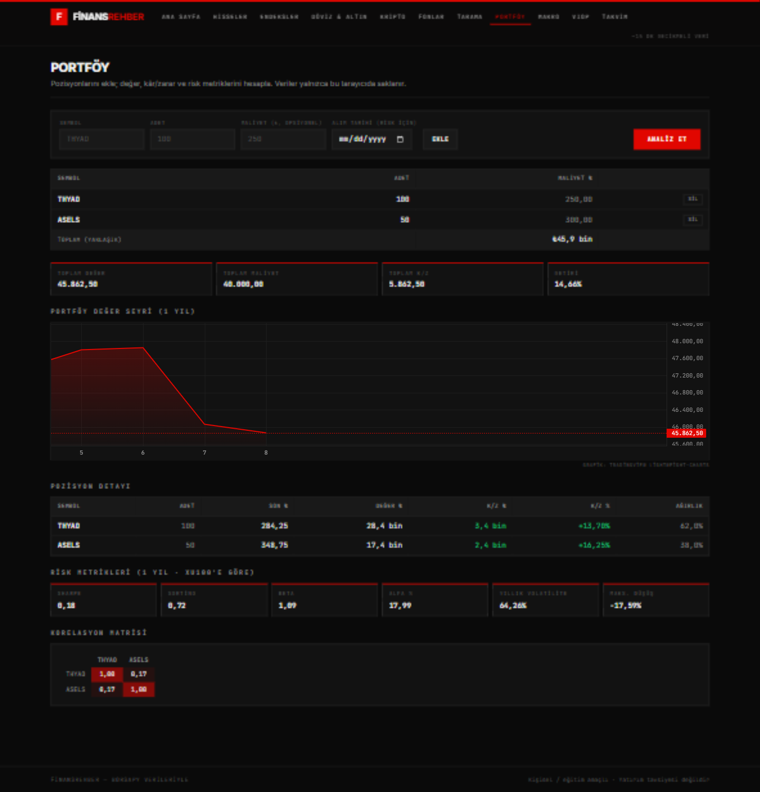
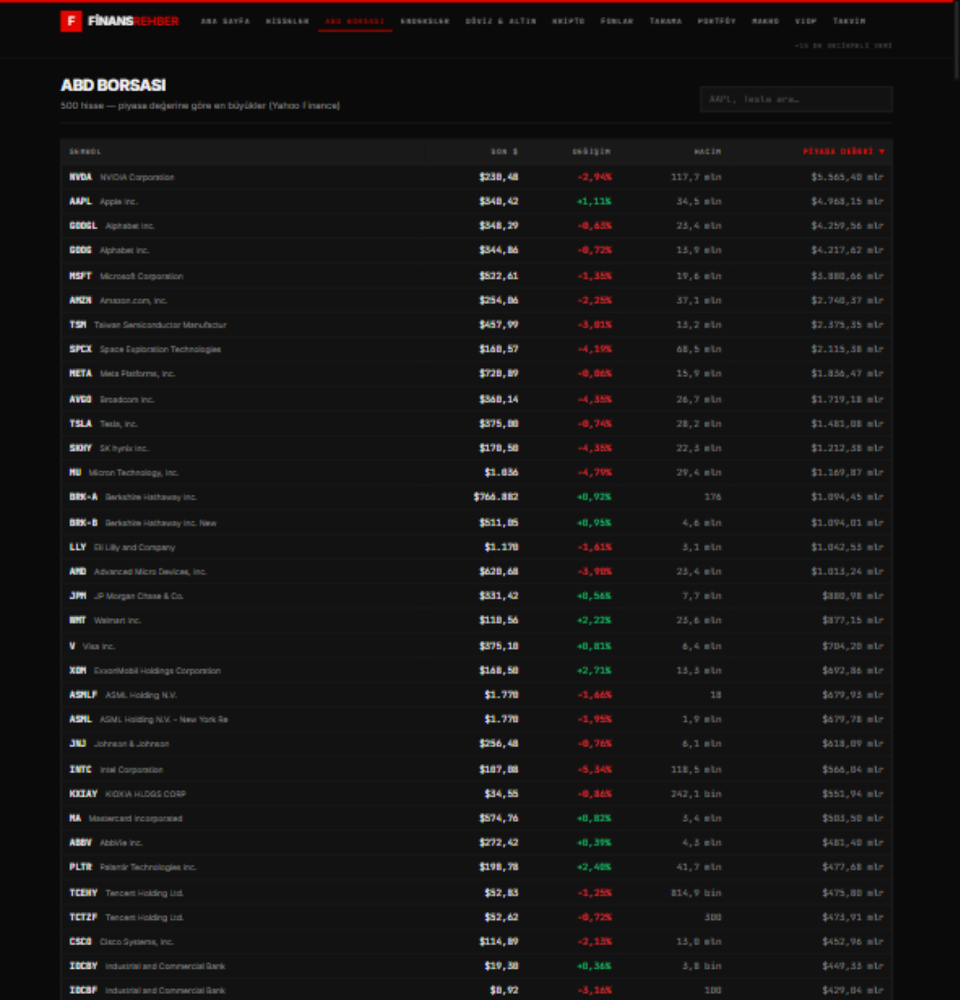

# FinansRehber

Türk finans piyasaları için masaüstü web panosu — [borsapy](https://github.com/saidsurucu/borsapy) kütüphanesinden veri çeker.

**Tasarım:** siyah + kırmızı, keskin çizgiler (oval/yuvarlak öğe yok), monospace rakamlar, yoğun finans görünümü.

| Ana Sayfa | Hisse Detayı |
|---|---|
|  |  |
| **Fon Detayı** | **Portföy** |
|  |  |
| **ABD Borsası** | |
|  | |

## Neden FastAPI köprüsü?

borsapy bir **Python** kütüphanesi olduğu için React'ten doğrudan kullanılamaz. FinansRehber bu yüzden iki katmanlı çalışır:

```
React (5173) ──/api──▶ FastAPI (8000) ──▶ borsapy ──▶ TradingView / İş Yatırım / TEFAS / BtcTurk / KAP / TCMB
```

Backend, borsapy çağrılarını temiz REST endpoint'lerine çevirir; pandas/NaN/timestamp gibi Python değerlerini JSON'a güvenle dönüştürür ve kendi TTL önbelleğini ekler.

## Kategoriler

| Sayfa | İçerik | Veri kaynağı |
|---|---|---|
| Ana Sayfa | Piyasa özeti: BIST endeksleri, **ABD endeksleri (S&P 500/NASDAQ/DOW)**, döviz, altın/emtia, kripto | TradingView, canlidoviz, BtcTurk, Yahoo Finance |
| Hisseler | 580+ BIST hissesi, arama/sıralama, detay (grafik, finansallar, temettü, KAP haberi, analist) | TradingView, İş Yatırım, KAP |
| **ABD Borsası** | **S&P 500 çekirdeğinin tamamı (~500 hisse, piyasa değerine göre), arama/sıralama, detay (grafik, F/K, 52 hafta, şirket özeti, haberler)** | **Yahoo Finance (yfinance)** |
| Endeksler | 33 BIST endeksi + bileşen hisseler | TradingView |
| Döviz & Altın | USD/EUR/GBP, gram altın/gümüş/**platin**, **platin & paladyum (ons $)**, Brent + 1 yıllık grafik | canlidoviz/doviz.com |
| Kripto | BtcTurk **₺ TRY ve $ USDT** pariteleri + grafik | BtcTurk |
| Fonlar | TEFAS yatırım/emeklilik fonları, getiriler, portföy dağılımı, risk | TEFAS |
| Tarama | Temel şablon/filtreler (F/K, temettü…) + teknik koşullar (RSI, MACD) | İş Yatırım, TradingView |
| Portföy | Pozisyon takibi, kâr/zarar, Sharpe/beta/korelasyon (veriler tarayıcıda) | borsapy Portfolio |
| Makro | Politika faizi, TÜFE, tahvil faizleri | TCMB |
| VIOP | Vadeli işlem sözleşmeleri | İş Yatırım |
| Takvim | Haftalık ekonomik takvim, önem filtresi | investing kaynaklı |

## Kurulum (Windows)

Gereksinimler: Python 3.10+, Node 18+

```bash
# Backend
cd backend
python -m venv .venv
.venv\Scripts\pip install -r requirements.txt

# Frontend
cd ../frontend
npm install
```

## Çalıştırma

İki yol:

1. **Kolay yol:** Proje kökünde `baslat.bat` dosyasına çift tıkla (iki pencere açar: backend 8000, frontend 5173).
2. **Elle:**
   ```bash
   # Terminal 1
   cd backend
   .venv\Scripts\python -m uvicorn app.main:app --port 8000
   # Terminal 2
   cd frontend
   npm run dev
   ```

Tarayıcı: **http://localhost:5173**

## Mimari

```
finansrehber/
├─ backend/           FastAPI (port 8000)
│  └─ app/
│     ├─ main.py      CORS + router bağları
│     ├─ helpers.py   JSON serileştirme (NaN/pandas uyumu)
│     └─ routers/     market, stocks, us (yfinance), indices, fx, crypto,
│                     funds, screener, portfolio, macro
└─ frontend/          Vite + React 19 + TypeScript + Tailwind v4 (port 5173)
   └─ src/
      ├─ api/         axios istemcisi + tipler (/api proxy → 8000)
      ├─ components/  Layout, PriceChart, StatCard, ChangeBadge…
      ├─ pages/       Ana Sayfa, Hisseler, ABD Borsası, Endeksler, Döviz,
      │               Kripto, Fonlar, Tarama, Portföy, Makro, VIOP, Takvim
      └─ lib/         tr-TR biçimlendirme
```

Önbellekleme: borsapy içinde TTL önbellek (fiyat 60 sn, grafik 1 saat, finansallar 24 saat) + FastAPI tarafında piyasa özeti 60 sn / endeks listesi 120 sn.

## Rehber AI — sesli finans asistanı (Gemini)

Sağ üstteki **"AI Analist"** sekmesi, Gemini 2.5 Flash ile çalışan kişisel finans asistanıdır:

- 🎤 **Sesli sor:** Mikrofon düğmesiyle konuş (tarayıcının konuşma tanıması, Chrome/Edge, tr-TR).
- 🔊 **Sesli cevap al:** Yanıtlar Türkçe sesli okunur; düğmeyle kapatılabilir.
- 📊 **Bağlam bilir:** Fon/hisse detay sayfasındaki "🤖 AI ile Analiz Et" düğmesiyle açılırsa o varlığın canlı verilerini (getiri, risk, F/K…) otomatik okuyup analiz eder.
- 📁 **Portföyünü bilir:** "Portföyüm dahil" açıkken portföyündeki pozisyonları değerlendirir.
- 🌐 **Web'de arar:** Güncel bilgi gerektiğinde Google Search ile arar, kullandığı kaynakları listeler.

Kurulum: [aistudio.google.com/apikey](https://aistudio.google.com/apikey) → ücretsiz anahtar al → `backend/.env` dosyasına `GEMINI_API_KEY=...` yaz → backend'i yeniden başlat. Anahtar sunucuda kalır, tarayıcıya gönderilmez. Rehber AI yatırım tavsiyesi vermez.

## Veri kaynakları ve sağlık panosu

Kodda **elle yazılmış veri linki yoktur** — tüm veriler `borsapy` ve `yfinance` kütüphaneleri üzerinden gelir; kırılma riski kütüphane bakımcılarına aittir ve iki kütüphane de aktif güncellenir.

| Sağlamlık | Kaynak | Beslediği sayfalar |
|---|---|---|
| Resmî | TEFAS, TCMB, KAP, BtcTurk | Fonlar, makro, haberler, kripto |
| Platform | TradingView, Yahoo Finance | Fiyat, grafik, tarama, ABD borsası |
| Scraper | İş Yatırım, canlidoviz/doviz.com | Finansallar, temettü, analist, döviz/altın |

Ana Sayfa'nın altındaki **"Veri Kaynakları" şeridi** 8 kaynağın canlı sağlığını gösterir (5 dakikada bir yenilenir); programatik erişim için `GET /api/health/sources` endpoint'i her kaynağın durumunu ve yanıt süresini (ms) döner. Bir kaynak kırılırsa uygulama çökmez: ilgili sayfa boş-veri durumuna düşer, diğerleri çalışmaya devam eder.

## Bilinen notlar

- Veriler **~15 dakika gecikmelidir** (ücretsiz katman). Canlı veri için ücretli TradingView hesabı gerekir.
- ABD borsası verileri Yahoo Finance'ten gelir; liste 10 dakikalık, detay 5 dakikalık önbellekle servis edilir.
- Veriler kişisel/eğitim amaçlıdır; ticari kullanım Borsa İstanbul lisansı gerektirir. **Yatırım tavsiyesi değildir.**
- borsapy "alpha" bir kütüphanedir; kaynak siteler değişirse bazı uçlar hata verebilir.
- İlk istekler yavaştır (kaynak sitelerden ilk çekim); sonrasında önbellek devreye girer.
- Portföy verileri yalnızca tarayıcınızın localStorage'ında tutulur, sunucuya kaydedilmez.

## Test

Her faz sonunda:
- Backend: her endpoint `curl` ile 200 + veri doğrulaması
- Frontend: `npm run build` (TS kontrolü) + tarayıcıda uçtan uca gezinti
- Görsel: her sayfa ekran görüntüsüyle bağımsız görsel denetimden geçirildi
